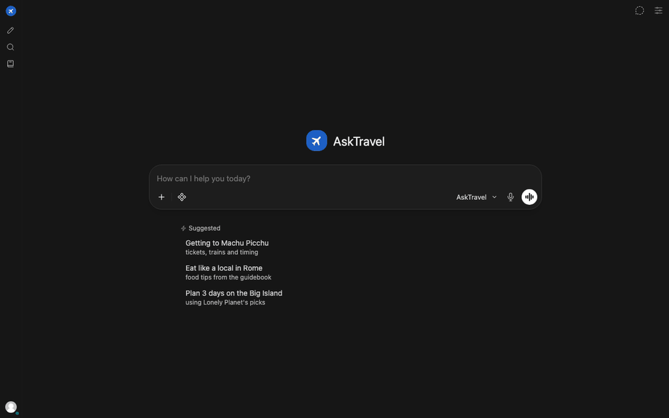

# AskTravel: a LangChain agent harness proof of concept


This project is a proof of concept (POC). It tests an **agent harness** built with LangChain v1.
The agent harness is all the parts that surround the model: the agent loop, tools, memory,
context control, skills, streaming, retries, tracing and evaluations.

A travel planner is the test case. The agent plans trips from guidebooks, live flight prices and
live hotel prices. The test case is not the product. The harness is what we test.



*The chat UI is Open WebUI. The **Thinking…** block shows each tool call and its result. Three
searches run in parallel. Then the answer streams as a day-by-day plan with page citations.
The wait plays at 2× speed.*

## Read the architecture first

The architecture documents explain the design with diagrams and measured data.
Start with these documents before you read the code.

| Document | What it shows |
|---|---|
| [Architecture](docs/architecture.html) ([open rendered](https://stoicdataguy.github.io/asktravel-agent-harness/architecture.html)) | Four tabs: the system components, how state persists in Postgres, the tools and skills, and how the context window grows and shrinks in a real 15-turn chat |
| [Memory architecture](docs/memory-explainer.html) ([open rendered](https://stoicdataguy.github.io/asktravel-agent-harness/memory-explainer.html)) | The four memory types (working, episodic, semantic, procedural), when the agent writes each type, and the eval results |
| [Plan and roadmap](docs/PLAN.md) | The decisions, the status of each milestone, and the known limits |
| [Detailed plans](docs/plans/) | One design document for each large feature: memory, streaming progress, knowledge base, feedback audit |

## What the harness tests

Each row is one part of the harness. Each part has a test or an eval that uses the real model.

| Harness part | How this POC does it | Evidence |
|---|---|---|
| Agent loop | LangChain v1 `create_agent` (ReAct on LangGraph). The model can call several tools in one step, and they run in parallel. | [Architecture](docs/architecture.html) |
| Tools | Guidebook search, flight search (Google Flights), hotel search (Playwright on Google Hotels), memory and trip tools. Each tool returns short text and never raises an error into the loop. | `scripts/e2e_flights.py`, `scripts/e2e_hotels.py` |
| Structured output | The final plan is a Pydantic `Itinerary`, sent as the argument of the `present_itinerary` tool. | `tests/test_itinerary.py` |
| Skills | Seven playbooks in markdown. The prompt holds only their names and descriptions. The agent loads a playbook when a request matches. | `scripts/eval_skills.py` (9/9) |
| Short-term memory | A Postgres checkpointer keeps each chat. The API keeps the thread correct when the user edits, regenerates or branches a chat. | `scripts/e2e_branching.py` |
| Long-term memory | A Postgres store keeps profile facts and trips for each user. Middleware adds them to the prompt on each model call. | `scripts/e2e_memory.py` |
| Episodic recall | An index of past chats, and a tool that searches the user's other chats. | `scripts/eval_memory.py` |
| Memory upkeep | A background job reviews saved facts when a user's chats are idle. It applies a change only if a quote from the user supports the change. | `scripts/eval_memory.py` |
| Context control | Earlier turns go to the model without their tool results. In the longest chat, this sends 62% fewer tokens, and 87% of input tokens come from the prompt cache. | [Context window tab](docs/architecture.html) |
| Streaming progress | Each tool call and its result stream into a block above the answer. Slow tools report their steps. | `scripts/e2e_progress.py` |
| Reliability | The harness retries rate-limited model calls and shows each wait to the user. | `tests/test_retry.py` |
| Tracing | LangSmith records each agent run with its model calls, tool calls and middleware steps. The traces of one chat are one thread. | `tests/test_observability.py`, LangSmith UI |
| User data | A user can see, export and delete all saved data. When a user deletes a chat in Open WebUI, the agent deletes its copy too. | `scripts/e2e_chat_deletion.py` |

## How the parts connect

```
Open WebUI (chat UI, :3000)
   │  OpenAI-compatible API: /v1/chat/completions, with the user's email in a header
   ▼
FastAPI (:8000) ── LangChain agent ── middleware: prompt + memories, compaction, retries
   │                    │
   │                    ├── tools ── guidebooks (local files), Google Flights, Google Hotels
   │                    └── model ── OpenRouter
   ▼
Postgres (:5433) ── chat threads, long-term memory, Open WebUI tables
LangSmith (cloud) ── traces
```

## Quick start

You need Docker, [uv](https://docs.astral.sh/uv/) and an [OpenRouter](https://openrouter.ai) API key.
For traces, you also need a free [LangSmith](https://smith.langchain.com) API key.

1. Copy the settings file: `cp .env.example .env`
2. Add your `OPENROUTER_API_KEY` to `.env`. For traces, add `LANGSMITH_API_KEY` too. Without it,
   set `LANGSMITH_TRACING=false`.
3. Install the dependencies: `uv sync`
4. Install the browser for hotel search: `uv run playwright install chromium`
5. Start Postgres and Open WebUI: `docker compose up -d`
6. Put your guidebook PDFs in `reference/`. Then convert them: `uv run travel-agent-ingest`
7. Start the agent API: `uv run travel-agent`
8. Open http://localhost:3000 and sign up with an email.

> **Note:** The guidebooks are copyrighted, so this repository does not include them. Use PDFs
> that you have the right to use. Without guidebooks, the flight, hotel and memory tools still work.

> **Note:** Each email is a different user with its own memory. Sign up with more emails to test
> more users. The password is not checked by the agent.

## Use the agent

**See the progress live.** In Open WebUI, open Settings → Interface. Turn on "Always Expand
Details". The block above the answer then shows each tool call as it runs:

```
Starting…
🔧 `search_guidebooks(query="Rome one week itinerary", book="italy")` → ✓ 6 passages · 0.4 s
🔧 `search_flights(origin="JFK", destination="FCO", …)` → ✓ 5 options, from $1,555 · 1.2 s
🔧 `search_hotels(location="Prati, Rome", …)`
   ⋯ search_hotels: dates set to Dec 9 → Dec 12, loading prices
   ✓ search_hotels → 3 hotels, from $107/night · 9.2 s
Reading the results…
```

The model does not see this block on the next turn. To put the lines in the answer, set
`PROGRESS_STYLE=inline`. To hide them, set `PROGRESS_STYLE=off`.

**Test the memory.** Tell the agent a lasting preference, for example "I am vegetarian". Start a
new chat and ask for restaurants. The agent uses the preference. Ask "What do you remember
about me?" to see the saved facts. Say "Forget my budget" to remove a fact.

**Get the saved data.** The API gives one user's data as JSON:

```bash
H="X-OpenWebUI-User-Email: you@example.com"
curl -s localhost:8000/api/itineraries -H "$H" | jq          # saved plans
curl -s localhost:8000/api/memory -H "$H" | jq               # facts, trips, chats
curl -s localhost:8000/api/memory/export -H "$H" > me.json   # all data, with messages
curl -s -X DELETE "localhost:8000/api/memory?confirm=you@example.com" -H "$H"   # delete all
```

**Look at the state.** Run `uv run jupyter lab` and open
[notebooks/inspect_state.ipynb](notebooks/inspect_state.ipynb). It shows the memories, plans and
decoded chat threads.

**Look at the traces.** Open https://smith.langchain.com and the `travel-agent` project. Each
chat is one thread. Each trace has the user's email in its `user_id` metadata. The evals do not
send traces unless you set `LANGSMITH_TRACE_EVALS=true`, so they do not use up the free plan.

## Tests and evals

| Command | What it checks | Uses the real model |
|---|---|---|
| `uv run pytest` | Unit tests, offline, with fake models | No |
| `uv run ruff check . && uv run ruff format --check .` | Lint and format | No |
| `uv run python scripts/eval_skills.py` | Each skill loads for the right requests | Yes |
| `uv run python scripts/eval_memory.py --quick` | Memory cases: recall, updates, trips, token use | Yes |
| `uv run python scripts/e2e_<feature>.py` | One feature end to end in a real browser | Yes |

The model provider allows about 20 requests each minute. Live evals are slow for this reason.
Run only the cases that your change can affect.

## Status and limits

This is a POC for learning and testing. It is not ready for public users.

- **Security:** The agent API trusts the user email in a request header. Do not expose port 8000
  to a network (issue #27).
- **Scraping:** Flight and hotel search read Google's pages. Google can change its pages or
  block the requests.
- **Branding:** The chat UI shows "AskTravel (Open WebUI)". The Open WebUI license allows a custom
  logo for up to 50 users.

## Project layout

| Path | Contents |
|---|---|
| `src/travel_agent/agent/` | Agent build, prompts, middleware (compaction, retries) |
| `src/travel_agent/tools/` | Agent tools |
| `src/travel_agent/skills/` | Skill playbooks |
| `src/travel_agent/api/` | FastAPI app, OpenAI-compatible routes, streaming progress |
| `scripts/` | Evals, end-to-end tests, demo recording |
| `docs/` | Architecture documents and plans |

The contributor rules and the full list of conventions are in
[.claude/CLAUDE.md](.claude/CLAUDE.md).

## License

The code and the documents are available under the [MIT License](LICENSE).

The license does not apply to the guidebooks, the Open WebUI image or the dependencies. Each
of these has its own license.
