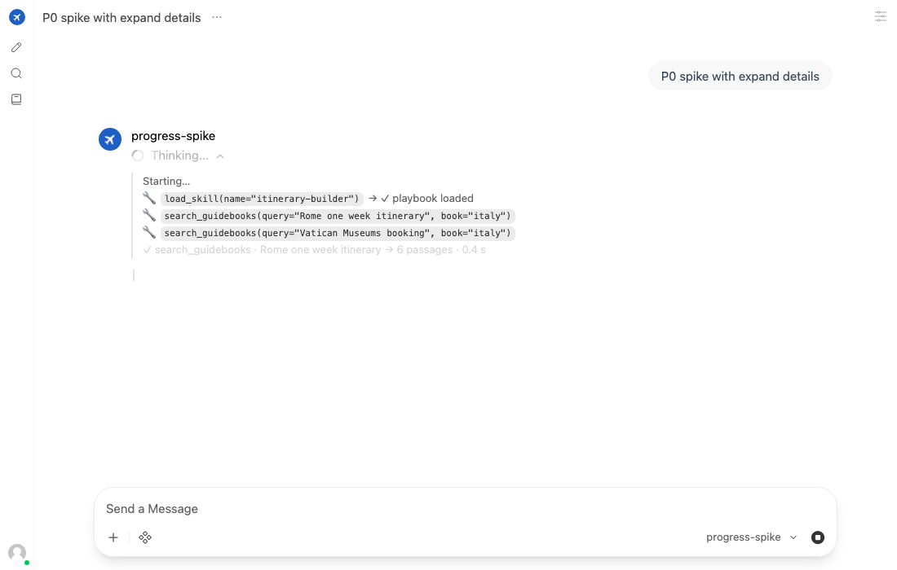
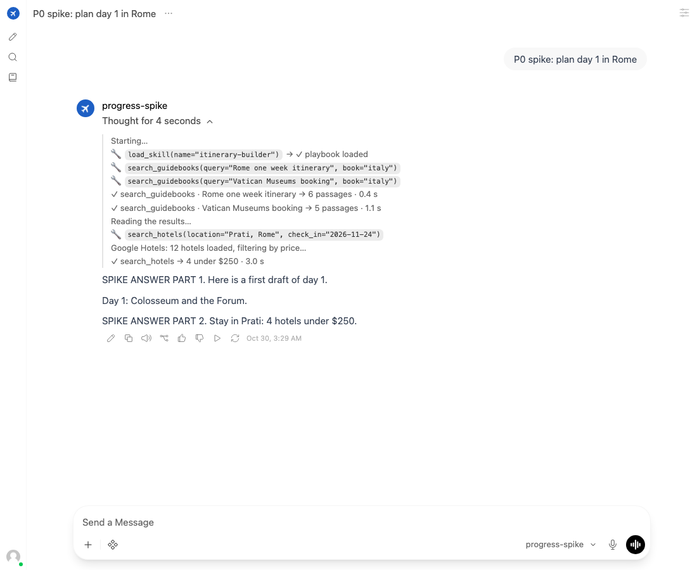

# Plan: streaming agent progress

**Goal:** while the agent works, show the user what it's doing, how far along it is and why it's
waiting, without cluttering the answer, without slowing the agent, and without building our own UI.

*Status: proposal, 2026-10-30. Supersedes issue #36 ("streaming polish"). Open WebUI behaviour
checked in its 0.12.4 source; timings from Langfuse.*

## Contents

- [1. Today](#1-today)
- [2. What users can't see](#2-what-users-cant-see)
- [3. The channel: Open WebUI's reasoning blocks](#3-the-channel-open-webuis-reasoning-blocks)
- [4. Design](#4-design)
- [5. What the user sees](#5-what-the-user-sees)
- [6. Evaluation](#6-evaluation)
- [7. Roadmap](#7-roadmap)
- [8. Risks](#8-risks)
- [9. Open questions](#9-open-questions)

## 1. Today

`openai_compat._stream` runs the agent with `stream_mode=["messages", "updates"]` and emits
OpenAI-style chunks:

| Source | What the user sees |
|---|---|
| `messages`: model tokens | the answer, as it's written |
| `updates`: each finished model step | one `🔧 tool(args)` line per tool call, **inside the answer text** |
| `updates`: tool results with an artifact | the rendered itinerary |
| an exception | a readable error line, then `[DONE]` |

This works, but:
- **The answer is cluttered.** A research turn prints 8–15 `🔧` lines above the answer, and they
  stay in the chat for good.
- **They pollute the transcript.** Open WebUI sends them back on the next turn as part of the
  assistant text. `thread_sync` strips them with a regex (`_STATUS_LINE`) before seeding a forked
  thread.
- **They only say what started.** Nothing says when a tool finished, what it found, or that a
  step is still running.

## 2. What users can't see

Measured gaps, longest first:

| Moment | How long | What the user sees now |
|---|---|---|
| A rate-limited model call waiting to retry (#51) | 30–50 s, on ~1 in 9 calls | nothing: the last `🔧` line just sits there |
| A hotel search (Playwright on Google Hotels) | 25–30 s each; two barely overlap | one `🔧 search_hotels(…)` line |
| A model step deciding what to do next | 2–3 s, up to ~15 per research turn | nothing between `🔧` lines |
| Parallel tool batches (76 seen, up to 10 tools) | 1–10 s | 10 lines at once, no sign of which finished |
| Memory being written or recalled | instant | a `🔧 save_memory(key=…)` line, with no sign it worked |

The first two are where users think the agent has hung.

## 3. The channel: Open WebUI's reasoning blocks

Open WebUI 0.12.4 (`utils/middleware.py`) treats a `reasoning_content` (or `reasoning`,
`thinking`) field in a streamed delta as reasoning:
- **Collapsible block.** Reasoning deltas fill a collapsible "Thinking…" block with a spinner;
  when answer text starts, the block closes as "Thought for N seconds".
- **One block per answer, not interleaved** (corrected by the P0 spike, below). The backend
  source suggests reasoning after answer text opens a second block, but the browser shows a
  **single** block above the answer. Later lines are appended to it after it has closed.
- **Not resent.** When it rebuilds the transcript for the next turn, Open WebUI **drops
  reasoning** for models like ours (`get_reasoning_format()` returns `None` unless the model is
  Ollama or llama.cpp). Progress never reaches the model or `thread_sync`.
- **Harmless elsewhere.** Other OpenAI-compatible clients ignore the unknown field.

So: **progress goes in `reasoning_content`, the answer stays in `content`.** No UI code, no
Open WebUI plugin.

### P0 spike results (2026-10-30)

A throwaway OpenAI-compatible server on :8010, added to Open WebUI as a second connection, streamed
a scripted turn: progress, the first half of the answer, more progress, the rest. Driven with
Playwright as the demo user; the setup was reverted afterwards.

| Question | Result |
|---|---|
| Is the stored answer clean? | ✅ The stored `content` holds only the answer |
| Is progress resent on the next turn? | ✅ No: the next request has the plain answer only, no extra fields |
| Does markdown render in the block? | ✅ Tool calls show as code spans, one per line |
| Is progress visible while the agent works? | ⚠️ **Only if expanded.** By default the user sees a collapsed "Thinking…" with a spinner. With Open WebUI's per-user **Always Expand Details** setting, lines appear live as tools start and finish |
| Does progress after answer text open a second block? | ❌ **No.** Everything is shown in one block above the answer; lines that arrive after the answer has started go into that closed block |
| Does the timer measure the work? | ⚠️ **It measures time to the first answer text** ("Thought for 4 seconds" for ~10 s of progress) |




**Why the single block is acceptable:** in the saved chats, only **4 of 126** tool-calling model
steps (3%) carried any text alongside their tool calls ("Let me check the Top 15…"). In 97%,
the answer starts after the last tool call, so all progress lands in the block before it closes.
For the rest:
- a prompt line asks the model not to narrate before tool calls;
- the timer then reads as "time spent researching".

**What it changes in the design:**
- **Live visibility needs the setting.** It's per user, so document it, and turn it on for the
  demo account in setup.
- **`PROGRESS_STYLE=inline` stays** for anyone who wants lines visible without it.

Rejected alternatives:

| Option | Why not |
|---|---|
| Keep `🔧` lines in `content` | The problems in §1 |
| Collapse the lines into a `<details>` block in `content` (#36's idea) | Still part of the answer, so still resent and regex-stripped; no live timer |
| Open WebUI "status" events (`__event_emitter__`) | Only available to Open WebUI functions and pipes running inside Open WebUI, not to an external OpenAI-compatible model |
| Our own UI | CLAUDE.md: no UI code of our own |

## 4. Design

**One progress stream, rendered in one place.**

```
agent.astream(stream_mode=["messages", "updates", "custom"])
   │ messages: model tokens ─────────────────────────────▶ content (the answer)
   │ updates:  model step with tool calls ─┐
   │ updates:  tool results ───────────────┤
   │ custom:   progress written by tools ──┼─▶ ProgressEvent ─▶ render ─▶ reasoning_content
   │ retry hook: waiting on a 429 ─────────┘
```

**`ProgressEvent`** (`api/progress.py`): kind, text, tool-call id, time. Kinds:

| Kind | Source | Example rendered line |
|---|---|---|
| `start` | stream opens | `Starting…` (sent at once, so something shows in < 0.5 s) |
| `tool_start` | `updates` (model step) | `` 🔧 search_guidebooks(query="Rome neighbourhoods", book="italy") `` |
| `tool_progress` | `custom` stream, from inside a tool | `   Google Hotels: 12 hotels loaded, filtering by price` |
| `tool_end` | `updates` (tools) | appended to the call's line: `→ ✓ 8 passages · 0.4 s` or `→ ✗ no flights found · 3.1 s` |
| `waiting` | model retry hook | `⏳ The model provider is busy; retrying in 20 s (attempt 2)` |
| `step` | a model step that follows tool results | `Reading the results…` |

- **The tool calls stay visible.** Every line shows the real call, as `🔧 name(args)` does today
  (args truncated the same way). Seeing which tools ran, with what arguments, is part of the
  point: for users who want to know how an answer was found, and for debugging. What's new is the
  outcome after it. Memory tools get the same treatment: `` 🔧 save_memory(key="dislikes",
  value="overnight flights") → ✓ saved ``.
- **Optional plain labels.** `PROGRESS_LABELS=calls|plain` (default `calls`). `plain` swaps the
  call for a short phrase from one template table ("Checking fares JFK → FCO, Nov 23"), for
  audiences who don't need tool names; unknown tools fall back to the call.
- **Results summarised in code, not by the model.** A `summarize(tool, result)` per tool reads
  its compact result: hit counts, the cheapest fare, the number of hotels. No extra model calls.
- **Parallel batches** print one start line per call, then each `✓` as it finishes. This needs
  per-call results, which `updates` gives because `create_agent` runs each call as its own task.
- **Progress from inside tools.** Slow tools call LangGraph's `get_stream_writer()`
  (`"custom"` mode): hotels per page and card count, flights per query. It's a no-op outside a
  stream, so evals and tests are unaffected.
- **Retry visibility.** Today the OpenAI client retries 429s silently inside one call. Move the
  retry loop into LangChain's `ModelRetryMiddleware`, or wrap `get_chat_model()`'s retry, with an
  `on_retry` hook that writes a `waiting` event. This also gives #51 the 429 body it wants to log.
- **Render target.** `PROGRESS_STYLE=reasoning` (default) puts lines in `reasoning_content`.
  `inline` keeps today's `🔧` lines in `content`, for clients that hide reasoning. `off` emits
  nothing. Non-streaming responses are unchanged.
- **Tracing.** Progress events are UI only. Langfuse already records the steps.

## 5. What the user sees

A research turn ("plan 3 days in Rome") in Open WebUI, while it runs:

```
▾ Thinking… 9s
  Starting…
  🔧 load_skill(name="itinerary-builder") → ✓ playbook loaded
  🔧 search_guidebooks(query="Rome one week itinerary", book="italy") → ✓ 6 passages · 0.4 s
  Reading the results…
  🔧 read_guidebook_pages(book="italy", start_page=65) → ✓ 1 page · 0.1 s
  🔧 search_guidebooks(query="Colosseum Forum tickets", book="italy") …
  🔧 search_guidebooks(query="Vatican Museums booking", book="italy") → ✓ 5 passages · 0.3 s
```

This is with Open WebUI's **Always Expand Details** on; without it, the user sees a collapsed
"Thinking…" with a spinner and clicks to see the lines. When the answer starts, the block closes
as `▸ Thought for 14 s`, above the answer. The itinerary still renders in the answer, as now.
The chat history keeps the block for the user to reopen; the model never sees it.

## 6. Evaluation

**`scripts/e2e_progress.py`** (browser, full stack, real model) checks:

| Check | Pass when |
|---|---|
| Time to first progress | a progress line is visible < 1 s after sending (today: ~2 s, after the first model step) |
| Answer is clean | the final answer text contains no `🔧` or progress lines |
| Progress is complete | every tool the trace shows has a start line and a `✓`/`✗` line, in the reasoning block |
| Ordering | progress lines appear in call order in one block above the answer, and none land after the answer has started (on research turns) |
| Not resent | the next turn's request body (logged by the API in the test) has no progress text |
| Waiting is visible | with a forced 429 (test hook), a `waiting` line appears and the turn still completes |

**Regression:**
- `e2e_branching.py`: fork, regenerate and edit still work; seeding no longer needs the regex,
  though it stays for older chats.
- `e2e_memory.py`.
- Unit tests: event building from recorded `updates` and `custom` payloads, every label and
  summary template, and the three render styles.

## 7. Roadmap

| Phase | Scope | Effort |
|---|---|---|
| **P0 Spike** ✅ | Streamed a scripted reasoning / content / reasoning / content turn to Open WebUI. Clean storage and no resend confirmed; a single block rather than two; live lines need Always Expand Details. Results and screenshots in §3 | ½ day |
| **P1 Progress in reasoning blocks** | `ProgressEvent` + renderer; `start`, `tool_start`, `tool_end`, `step`; tool calls shown with their outcome, code summaries for all 13 tools; optional plain labels; `PROGRESS_STYLE` and `PROGRESS_LABELS` settings (+ `.env.example`); `e2e_progress.py` | 1–2 days |
| **P2 Progress from inside tools** | `get_stream_writer` in `search_hotels` and `search_flights`; `"custom"` stream mode | ½ day |
| **P3 Waiting is visible** | Model retries via a hook that emits `waiting` and logs the 429 body (with #51) | ½–1 day |
| **P4 Docs** | architecture.html (data flow: progress channel), README screenshots, CLAUDE.md conventions (labels table, "progress never in `content`") | ½ day |

Each phase is one PR. P1 alone fixes the clutter; P2 and P3 fix the "is it stuck?" moments.

## 8. Risks

| Risk | Mitigation |
|---|---|
| Open WebUI changes how it handles `reasoning_content` | P0 records the behaviour; `e2e_progress.py` catches a change; `PROGRESS_STYLE=inline` is the fallback |
| Reasoning blocks look like the model's thinking | Lines are tool calls and their outcomes, not first-person thoughts; the block title is Open WebUI's |
| Very long research turns make long blocks | One line per tool; collapsed by default once the answer starts |
| Progress text leaks private arguments | Same exposure as today's `🔧` lines (the user's own chat); the user id is never a tool argument. `plain` labels show only chosen fields |
| Moving retries changes error behaviour | P3 keeps the same retry counts and backoff; `test_resilience.py` covers 429 → readable error |

## 9. Open questions

- **Keep the old in-answer `🔧` lines as an option?** They help in clients that hide reasoning;
  `PROGRESS_STYLE=inline` costs little to keep.
- **Should the itinerary also stream progressively** (day by day) instead of appearing at once?
  It's produced by one tool call, so it would need a different design. Out of scope here.
- **Percentages?** The agent can't know how many steps remain. Show counts ("3 of 5 searches
  done") only within a parallel batch, where the total is known.
